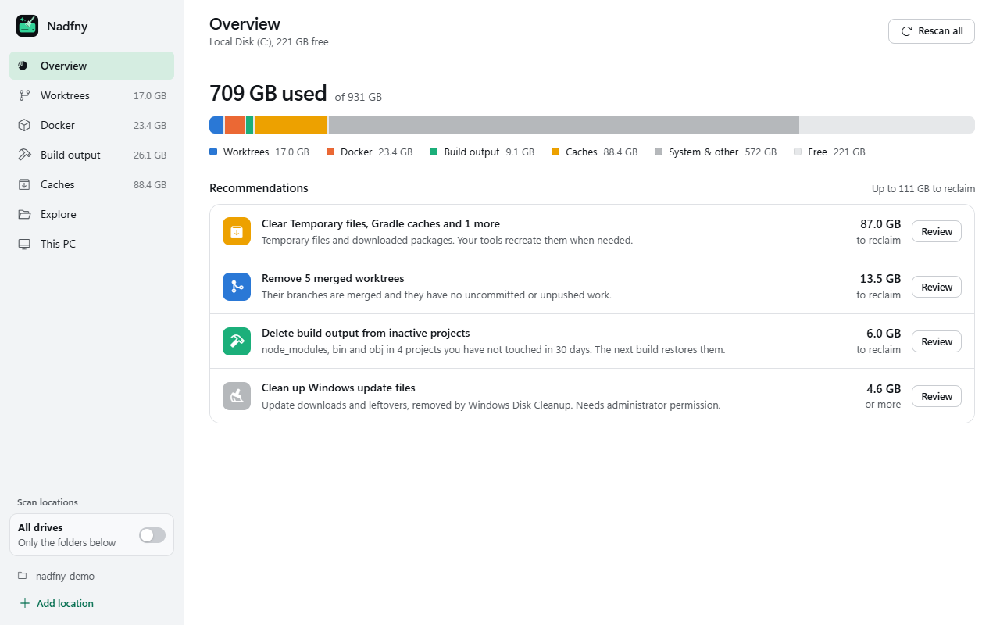
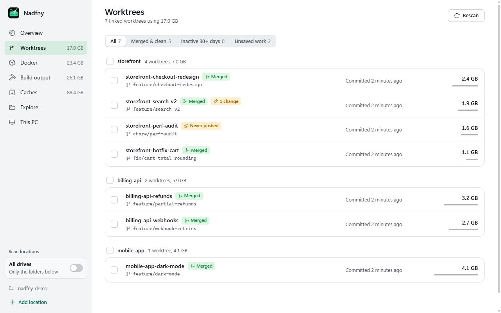
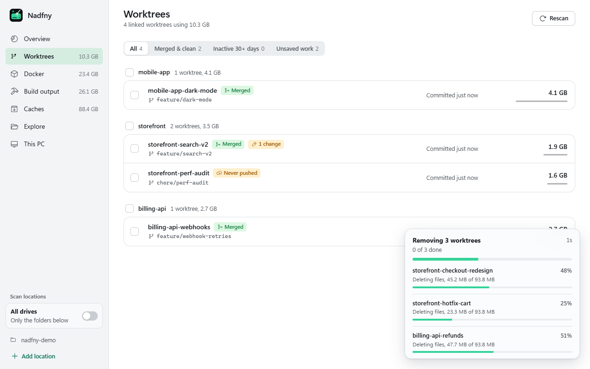
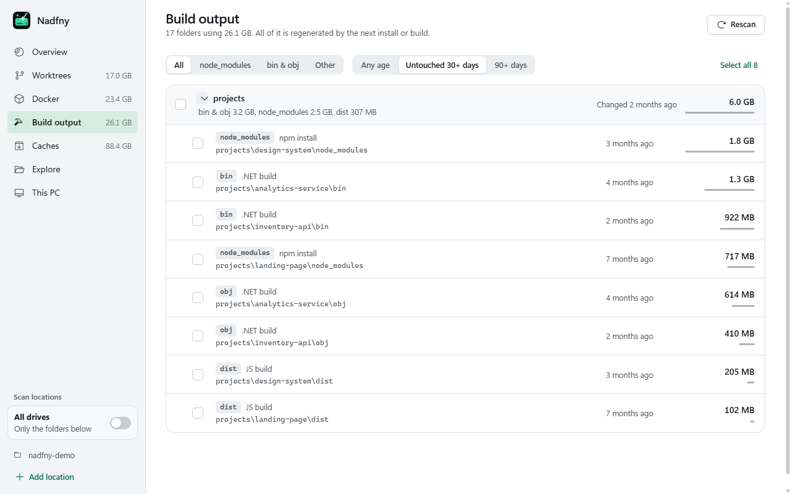
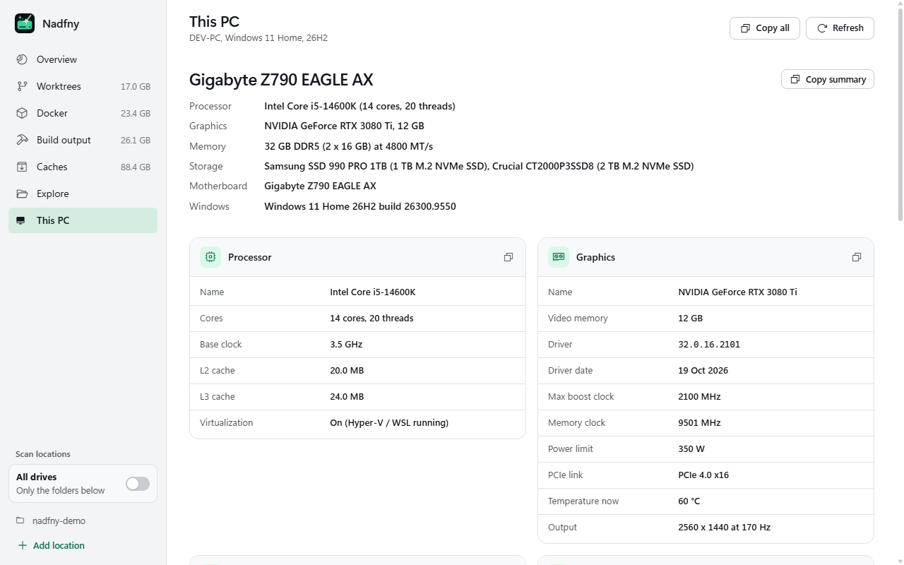
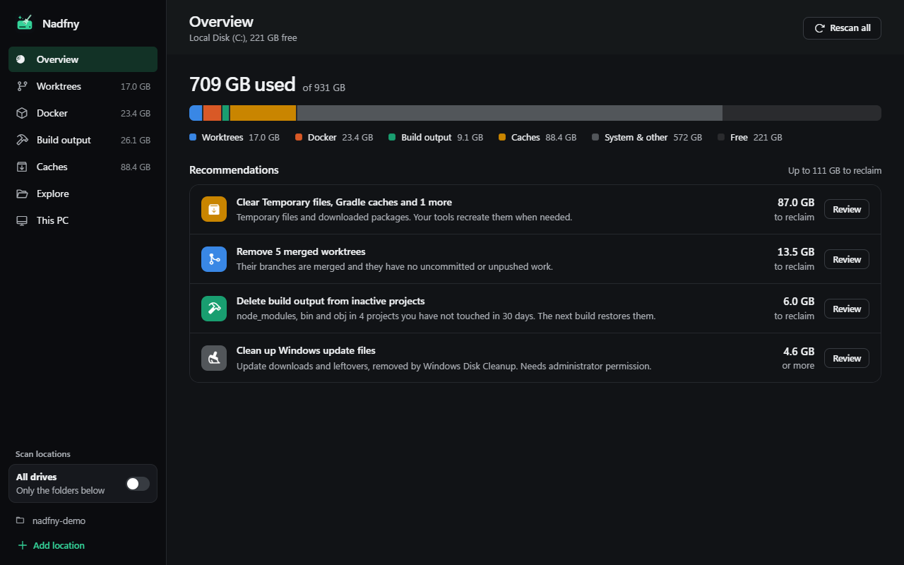

<p align="center">
  
</p>

<h1 align="center">Nadfny</h1>

<p align="center">
  <b>Find what is eating your disk, and clean it up safely.</b><br>
  A fast Windows cleaner built for developers: git worktrees, Docker, build output, package caches and Windows update leftovers.
</p>

<p align="center">
  <a href="https://github.com/mfathy234/nadfny/releases/latest"><b>Download for Windows</b></a> · <a href="https://nadfny.pages.dev/">Website</a>
</p>

<p align="center">
  
</p>

*Nadfny* (نضّفني) is Egyptian Arabic for "clean me".

Generic cleaners empty the Recycle Bin and browser caches. The space a developer actually loses goes somewhere else: a dozen forgotten git worktrees, Docker images and build cache, `node_modules`, `bin` and `obj` in every project you ever cloned, and gigabytes of package caches. Nadfny measures all of it in seconds, tells you what is safe to remove, and removes it with live progress.

## What it cleans

| Area | What you get |
| --- | --- |
| **Storage history** | Up to 90 days of drive usage and scan totals, the top five growing items, and growth hints in Build output, Caches and Apps & games. Stored locally with a 5 MB limit; clear it from Overview. |
| **Worktrees** | Every linked worktree across your repos, with size, branch, last commit and badges for *Merged*, *uncommitted changes*, *unpushed* and *never pushed*. Filter to "Merged & clean" and remove them in one go, optionally with their branches. |
| **Docker** | Build cache, images, containers and volumes with their real sizes, one-click prunes, and compaction of Docker's WSL disk file so freed space actually returns to Windows. |
| **Build output** | `node_modules`, `bin`/`obj`, `dist`, `target`, `.next`, `.venv`, Unity, Godot, Flutter, Elixir, CocoaPods, CMake, Gradle and Python caches. Grouped by project with tool labels, source activity age filters through 1+ year, and size or oldest-first sorting. |
| **Caches** | npm, pnpm, Yarn, NuGet, pip, Gradle, Maven, Playwright browsers and Temp; Go modules/builds, uv, Poetry, Conda, Bun, Deno, Composer, Cargo, VS Code extension downloads, JetBrains caches/logs and Visual Studio component caches. Review older .NET SDK patches with global.json pin checks and copy uninstall commands; remove per-user Android images or move emulator data and old JetBrains folders to the Recycle Bin. AI models from Ollama, Hugging Face and LM Studio are listed by size: single Ollama models are removed with `ollama rm`, Hugging Face models are deleted and downloaded again on next use, and LM Studio models go to the Recycle Bin. Per-user crash dumps and error reports are cleared here; Windows update leftovers and system crash dumps (memory dumps, minidumps, error reports) use Windows' own Disk Cleanup. |
| **Apps & games** | Every installed app and game with its program size, the data it keeps in AppData and ProgramData, and its caches. Clear an app's cache in one click, uninstall it through its own uninstaller, then review the folders it left behind (they go to the Recycle Bin). Games are found in Steam, Epic, Xbox, GOG, Ubisoft, EA and Battle.net, and also in plain folders such as `D:\Games\Racing\…`, recognized by their engine files (Unity, Unreal, Godot, GameMaker, RPG Maker, Ren'Py). |
| **Broken apps & bulk uninstall** | Remove broken app entries after backing up their registry keys, then recycle reviewed leftovers. Select multiple apps to uninstall one at a time, quietly where supported, with a combined leftover review. Shared folders and protected locations are kept. |
| **Recycle Bin** | How much the Bin holds on each drive, and emptying it, since deleted files only free space once it is emptied. |
| **Windows space** | Hibernation file size, confirmed controls to turn it off or reduce it, pagefile and swapfile sizes per drive, and restore-point counts and shadow storage usage. Pagefile and restore settings open in Windows; Nadfny does not delete restore points. |
| **Explore** | Drill into any drive or folder by size, reveal in Explorer, or delete to the Recycle Bin. |
| **Large files** | Find files over 100 MB, 500 MB or 1 GB in your scan locations, review Downloads untouched for 30, 90 or 180 days by type, and find verified duplicates of at least 1 MB without counting hard links. Move selected items to the Recycle Bin; duplicate groups always keep at least one copy. |
| **This PC** | CPU, GPU (with real VRAM and clocks), every RAM stick, every drive (NVMe, SATA, HDD), displays, motherboard and BIOS, each with a copy button. It even tells you when your RAM is running below its rated speed. |

Scan your project folders, or switch on **All drives** to scan every local disk.

<p align="center">
  
</p>

## Built to never lose your work

Deleting is the easy part. Nadfny is designed around not deleting the wrong thing.

- **Every delete is confirmed** in a dialog that names exactly what will be removed and how big it is.
- **Worktrees with unsaved work** (uncommitted changes, unpushed commits, a lock, or a git status that could not be read) need an extra explicit acknowledgement. Unknown always counts as risky.
- **Changed since the scan?** Right before removing a worktree, Nadfny re-checks it with git. If you edited it after the scan, it is kept.
- **Build output is verified before deletion.** A folder is kept if git tracks any file inside it, or if it contains hand-written source code (`.cs`, `.razor`, `.csproj`, `.ts`, `.py` and others). Generated files such as `*.g.cs` or files marked `<auto-generated>` do not count. Committed `dist` folders and similar stay put.
- **System folders are off limits.** Drive roots, Windows, Program Files, ProgramData, your profile and AppData (and anything that contains them) are refused by the deletion engine itself, not just hidden in the UI.
- **Junctions and symlinks** are removed as links. Their targets are never touched.
- **Temp is cleaned conservatively.** Anything with a file changed in the last 24 hours stays.
- **Windows update cleanup** runs Microsoft's Disk Cleanup with a fixed list of safe categories. Old driver packages are deliberately excluded.

## Fast, with progress you can see

Worktree folders are moved aside instantly, git lets go of them, and the files are deleted in the background by a parallel deleter that is about twice as fast as Windows' own. Everything in flight shows in a progress panel with live byte counts, and if you close the app mid-delete it finishes the job next time it starts.

<p align="center">
  
</p>

## Download

Get the latest version from [Releases](https://github.com/mfathy234/nadfny/releases/latest):

- **`Nadfny-<version>-setup.exe`**: installer (recommended). Installs for your user only (no administrator rights), adds a Start menu entry, and upgrades in place.
- **`Nadfny-<version>-win-x64.msi`**: the same installer as a bare MSI, for IT and scripted installs.
- **`Nadfny-<version>-portable-win-x64.zip`**: portable. Unzip anywhere and run `Nadfny.exe`. Nothing to install.

All of them include the .NET runtime, so there is nothing else to download.

**Updates:** Nadfny checks GitHub for a new release shortly after it starts and every few hours (or use *Check for updates* in the sidebar). The installed version downloads the new installer, verifies it against the release's SHA-256 checksums, and upgrades in place when you choose *Restart to update*. The portable version shows the update and links to the release page.

**Requirements:** Windows 10 or 11 (x64) with the Microsoft Edge WebView2 Runtime, which is already part of Windows 11. `git` and Docker are optional; their sections light up when they are installed.

> Nadfny is a new, unsigned app, so Windows SmartScreen may warn you the first time you run it. Choose **More info**, then **Run anyway**.

## Screenshots

| | |
| --- | --- |
|  |  |
| Build output, untouched for 30+ days | This PC |
|  |  |
| Dark mode follows Windows | Live progress while deleting |

## Build from source

You need the [.NET 10 SDK](https://dotnet.microsoft.com/download) on Windows.

```powershell
git clone https://github.com/mfathy234/nadfny.git
cd nadfny
dotnet run --project src/Nadfny          # run it
dotnet test tests/Nadfny.Tests           # run the tests
pwsh build/release.ps1                   # build the portable zip, MSI and setup.exe into ./artifacts
```

The installer is built with [WiX Toolset](https://wixtoolset.org/), restored automatically as a local `dotnet` tool (the setup.exe also uses the `WixToolset.Bal.wixext` extension, which `build/release.ps1` installs on first run).

### How it is put together

- **Backend:** C# / .NET 10 in a small WinForms host. Scanning uses raw directory enumeration fanned out across all cores; git and Docker are driven through their CLIs.
- **UI:** plain HTML, CSS and JavaScript (no framework) rendered by WebView2 and served from the app folder, talking to the backend over a small JSON message bridge.
- **Icons:** [Phosphor Icons](https://phosphoricons.com/) (MIT).

```
src/Nadfny/
  Core/        directory sizing, the safe deleter, progress reporting
  Features/    worktrees, docker, build output (with the source-code guard), caches, windows cleanup, explore, system info
  Bridge/      JSON RPC between the UI and the backend
  wwwroot/     the interface
tests/         unit and integration tests (real git repos and file trees in a temp folder)
installer/     WiX sources for the MSI and the setup.exe bundle
build/         release script
```

## License

[MIT](LICENSE)
